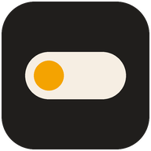
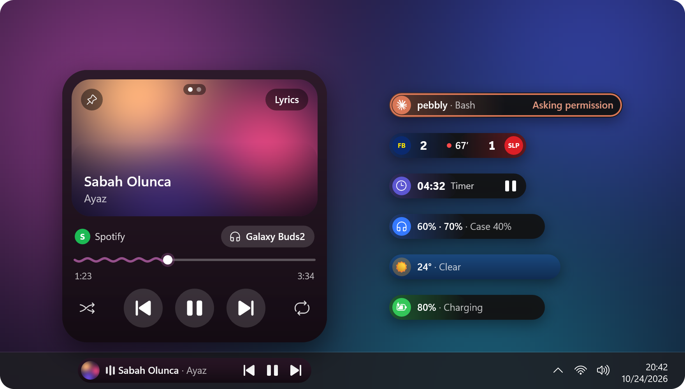
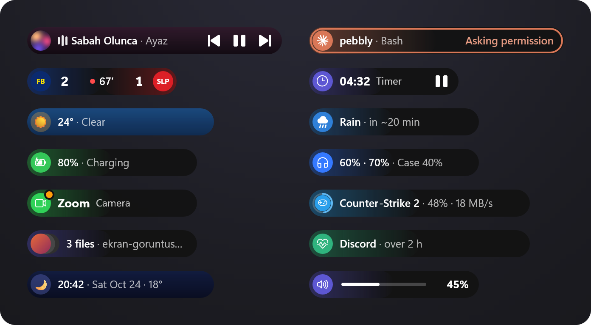
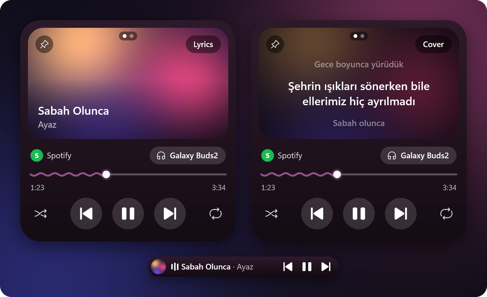
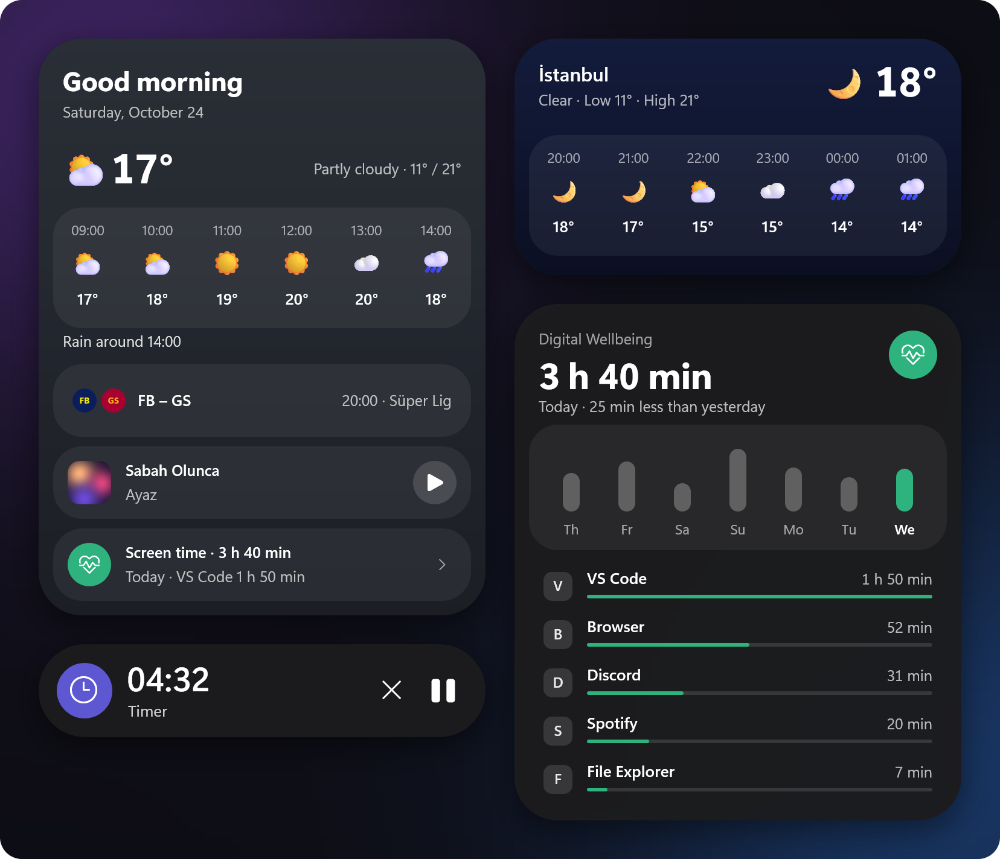
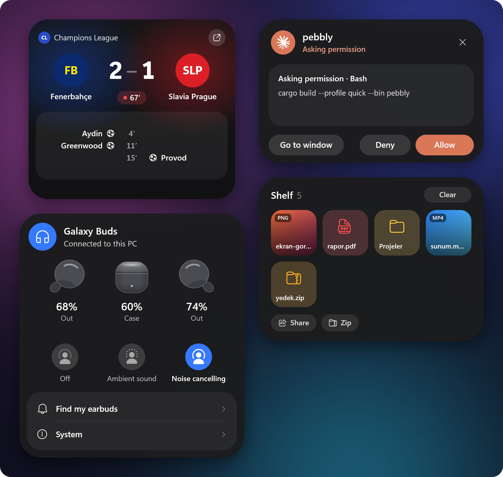
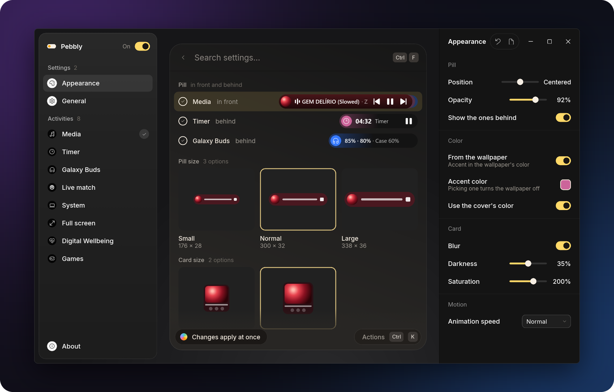
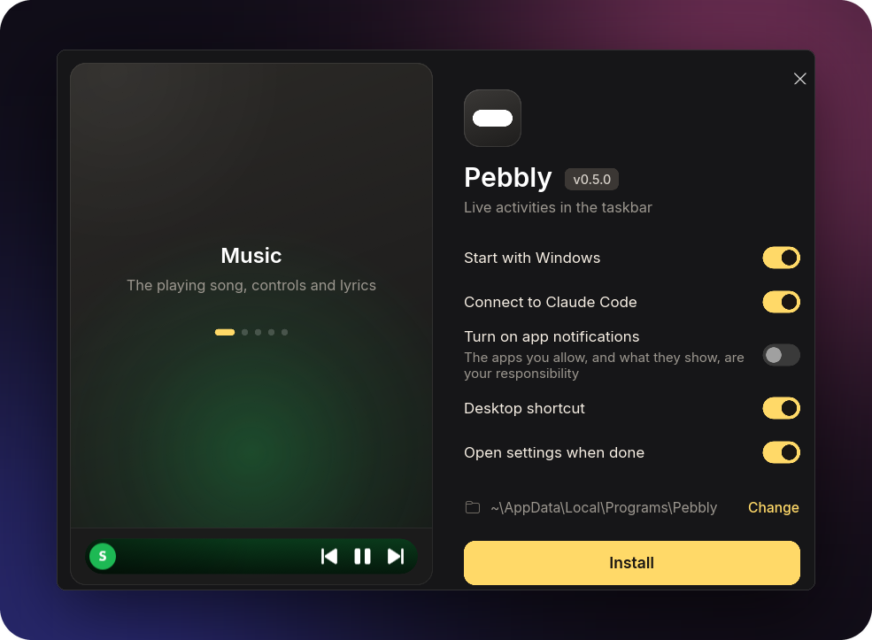

<div align="center">



# Pebbly

**Live activities in the taskbar.**<br>
A small pill for Windows 11 and 10, inspired by Samsung One UI's Now Bar.

[](https://github.com/nixesty/pebbly/releases/latest)
[](#known-limits)
[](LICENSE)

**[Download](https://github.com/nixesty/pebbly/releases/latest)** &nbsp;·&nbsp;
[pebbly.bar](https://pebbly.bar) &nbsp;·&nbsp;
[Türkçe](README.md)

<br>



</div>

<br>

A small pill sits in the taskbar and shows what's going on right now: the song that's playing, a
timer, a match's score, what Claude Code is doing. Click the pill and a card opens above it; move
the mouse away and it goes back into the pill. The app speaks English and Turkish.

## What it shows



| Activity | What it shows |
|---|---|
| **Music** | Any app that opens a media session (Spotify, YouTube Music, browsers). The pill takes the cover's colour; with synced lyrics, the current line scrolls instead of the title. |
| **Timer and stopwatch** | Started from the picker (Win+Alt+N) or the tray menu; when time is up an alarm rings and the card opens. |
| **Live match** | The score, minute and goals of the football and basketball teams you follow. |
| **Weather** | The clock and the weather when nothing else is on; alerts for rain, snow, storms, strong wind, extreme heat, frost and poor air quality. |
| **Galaxy Buds** | Both earbuds' and the case's charge, noise control; opening the case offers to connect them to the PC. |
| **Claude Code** | What Claude is doing, its task list and its permission requests; **Ask Claude** asks a question right in the card. |
| **Games** | Steam and Epic Games downloads, updates, pauses and play time. |
| **Digital Wellbeing** | The day's screen time, each app's share, the limits you set, and the week's music. |
| **Shelf** | Files you drop on the pill and new screenshots wait there until you drag them where you want them. |
| **File copying** | While Explorer copies, moves or deletes: the percentage and the time left. |
| **While you were away** | What happened while the PC was locked: work Claude finished, goals, alerts, finished downloads. |
| **System** | Volume, charging and low battery, the app using the microphone or camera, Bluetooth headphones. |

With more than one activity at a time, thin strips show to the right of the one in front; turn the
mouse wheel over the pill to switch. While a game, a video or a slideshow is full screen the pill
hides; what can't wait (Claude asking permission, a weather alert) shows on a small island at the
top of the screen.

## Cards

### Music



The card has the cover, a wavy progress bar and a choice of audio output. **Lyrics** in the cover's
corner opens the lyrics: they come from `lrclib.net`, or when it doesn't have them from NetEase
Cloud Music or Kugou, and they flow with the song. When none of them has a slowed or sped-up
edit's lyrics, the original's are stretched to its length.

### Your day



When nothing else is on, a click on the clock opens the day's summary: the weather, matches, the
last song played and screen time. **The week's music** shows your most played songs and artists of
the last seven days; it opens from the Digital Wellbeing card or the tray menu.

### Live



- The **Galaxy Buds** card is like Galaxy Wearable's: the earbuds and the case, their charge,
  where they are, their temperature, the listening time left and noise control. On Buds2 there are
  also the equalizer, ambient sound, find my earbuds, touch controls, touch and hold (it can mute
  the PC's microphone or skip the song), double tap the edge, hearing your own voice in calls,
  seamless connection and the fit test; these are kept in the earbuds and apply on the phone too.
  With more than one pair paired, the settings pick which one is shown.
- When **Claude Code** asks for permission, the card shows **Allow / Deny**
  ([below](#apps-and-scripts)).
- The **Shelf**'s buttons act on the files you selected (all of them with none selected):
  **Share** (Windows' share window; to your phone too if Quick Share is installed), **Copy text**
  (puts a screenshot's text on the clipboard), **Shrink** (a JPEG next to the original, its long
  side 1920 pixels at most) and **Zip**.

## Settings



The settings window opens from **Settings…** in the tray menu; every change shows on the pill at
once. The search at the top finds settings; on the Live match page it searches for teams, on the
Full screen page it adds exceptions. Ctrl+F goes to the search, Ctrl+K to the actions menu. The
language is in General → Language (Windows' language by default).

## Install



1. Download `pebbly-setup.exe` from the [latest release](https://github.com/nixesty/pebbly/releases/latest).
2. Run it. It needs no admin rights and installs to `%LOCALAPPDATA%\Programs\Pebbly` (**Change**
   picks another folder).
3. The options: **Start with Windows**, **Connect to Claude Code** (shown when Claude Code is on
   the PC), **Turn on app notifications** (off by default), **Desktop shortcut**, **Open settings
   when done**.

A Start menu shortcut is always added. Running the setup again updates or repairs Pebbly. Pebbly
is uninstalled from Windows' Settings → Apps; the shortcuts, start with Windows and the Claude Code
hooks go too, and deleting the settings is up to you.

<br clear="right">

Silent install: `pebbly-setup.exe --quiet` (it leaves the app notifications setting as it is).
Silent uninstall: `"%LOCALAPPDATA%\Programs\Pebbly\pebbly-setup.exe" --uninstall --quiet`.

> [!NOTE]
> **Coming from Now Bar:** Pebbly used to be called Now Bar. Now Bar 0.5.0 or older moves to Pebbly
> with the **Update** row in About or with `pebbly-setup.exe`. The settings, log and caches (the
> `%APPDATA%\NowBar` and `%LOCALAPPDATA%\NowBar` folders become `Pebbly`), start with Windows,
> the Claude Code connection and the shortcuts stay as they were; `%LOCALAPPDATA%\Programs\NowBar`
> moves to a `Pebbly` folder beside it. If your own scripts call `nowbar.exe push`, make it
> `pebbly.exe push`.

## Usage

| What | How |
|---|---|
| Open / close the card | Click the pill; the card closes by itself when the mouse leaves |
| Play / pause | Middle-click the pill |
| Switch between activities | Mouse wheel over the pill or the card |
| Timer picker | Win+Alt+N (can be changed in Settings → General) |
| Ask Claude | Win+Alt+C or Ctrl-click the pill (can be changed in Settings → General) |
| Select files on the shelf | Click a file on the card; click again to deselect it |
| Tray menu | Now Brief, Digital Wellbeing, The week's music, Ask Claude, Start a timer or the stopwatch, Start with Windows, Settings…, Quit; **Update: x.y.z** at the top when there's a new version, **Open the match page** and **Hide the match** during a match |

**Ask Claude** needs Claude Code installed and signed in on the PC (run `claude` once in a
terminal, then `/login`).

## Apps and scripts

**From a script:** another program or a script can show an activity on the pill. When Pebbly
isn't running, the command quits without doing anything (its exit code is always 0, no output):

```
pebbly.exe push --id backup --title "Backup" --text "Documents" --progress 40
pebbly.exe push --id backup --title "Backup" --state done
```

`--state`: `run` (the default), `wait` (waiting for the user; comes to the front for a moment),
`done` (shows "Done" for 5 seconds), `clear` (removes it at once). An activity not updated for an
hour goes away by itself. Settings → System → Live activities turns this off.

**An API for apps:** other apps can show a notification or a live activity on the pill with a
single HTTP request, with their own icon, colour and up to two buttons. The API answers only on
this PC (`127.0.0.1:20034`) and stays off until you turn it on (**Turn on app notifications** in
the setup, or Settings → System → App notifications). The first time an app sends a request, the
pill asks ("Wants to show notifications"); your answer is remembered. The apps you allow, and what
they show, are your responsibility; Pebbly only shows it. For developers: [DOCS.md](DOCS.md).

```
curl -H "Content-Type: application/json" -d "{\"app\":\"Backup\",\"title\":\"Backup done\"}" http://127.0.0.1:20034/v1/notify
```

**Claude Code:** the setup's **Connect to Claude Code** installs the hooks; to install or remove
them by hand, use the commands below. The command writes the exe's own path, keeps a backup
(`settings.json.before-pebbly` the first time, `settings.json.pebbly-last` on every later write)
and leaves other hooks alone:

```
pebbly.exe claude-hooks install
pebbly.exe claude-hooks remove
```

The pill shows what Claude is doing and for how long ("pebbly · Editing: app.rs"); the card has
the task list's progress, the last steps and, when the work is done, the first line of the answer
("Done · 12 min · 9 files"). The card's **Allow / Deny** covers only single-line commands, files,
addresses and searches it shows in full; for a file, it shows the full path while the change
itself stays in Claude's window. Multi-line commands, questions and plan approval are answered in
Claude's window. Both stay open; whichever answers first counts. The card waits 60 seconds
(Settings → System → Live activities). It works in the desktop app's Code tab, the CLI and VS Code;
if Pebbly moves to another folder, the hooks follow it the next time it starts.

## Updates

A minute after it starts, and then once a day, Pebbly asks GitHub for the latest release
(`api.github.com`; nothing is sent but the request). **Check** in Settings → About asks without
waiting. When there's a newer one, **Update: x.y.z** shows in the tray menu and the About row turns
into **Update**. A click downloads the two exes, checks them against `SHA256SUMS.txt`, puts them in
place of the old ones and restarts Pebbly; an open settings window reopens in place with the new
version too. The About row says what is happening and, if it fails, why; if a step fails, the old
exes stay. If Pebbly is installed in a folder it can't write to (such as Program Files), the
release page opens instead. Settings → About → Check for updates turns the daily check off.

## Files

| What | Where |
|---|---|
| Settings | `%APPDATA%\Pebbly\settings.json` |
| Log | `%LOCALAPPDATA%\Pebbly\log.txt`: when and why the pill hid is here too (`pill: hidden (nothing active)` and the like) |
| Team crests | `%LOCALAPPDATA%\Pebbly\crests\` |
| The week's music | `%LOCALAPPDATA%\Pebbly\music.json` (the last seven days only) |
| What the shelf makes | Shrunk pictures and zips go next to their originals; when that folder can't be written to, into `%LOCALAPPDATA%\Pebbly\Raf\` |

## Privacy and network

Where Pebbly connects; none of them needs an API key:

| What | Where | What goes there |
|---|---|---|
| Lyrics | `lrclib.net`, then NetEase Cloud Music (`music.163.com`) and Kugou (`lyrics.kugou.com`) | The playing song's artist, title and length (Settings → Media → Lyrics turns it off) |
| Weather | Open-Meteo (`api.open-meteo.com`, `geocoding-api.open-meteo.com`) | The chosen city's coordinates |
| The place's name | OpenStreetMap (`nominatim.openstreetmap.org`) | With **Use my location**, coordinates rounded to about 1 km (the location comes from Windows, which asks first) |
| Matches | ESPN (`site.api.espn.com`), EuroLeague/EuroCup (`feeds.incrowdsports.com`, `live.euroleague.net`) | Score requests for the teams you follow; crests come from these sources too |
| Updates | GitHub (`api.github.com`) | Only the latest release request |
| Ask Claude | Claude Code on the PC (`claude -p`, with no tools) | Your question; Claude Code sends it to Anthropic with your own session |

What stays on this PC: the week's music is counted here; **Copy text** uses Windows' own text
recognition; **Share** only opens Windows' share window. While the paired Buds aren't connected to
this PC, Pebbly listens to nearby Bluetooth LE adverts to see the case open (it only listens and
sends nothing); Settings → Galaxy Buds → **Offer to connect when the case opens** turns this off.

With **app notifications** on, Pebbly listens only on `127.0.0.1:20034` and `[::1]`, which only
this PC can reach (if the port is taken, it writes the one Windows gives to
`%LOCALAPPDATA%\Pebbly\api.json`); with them off, no port is opened. Requests from web pages, the
network and other Windows users on this PC are refused. ShareX's screenshot folder and Windows'
`Pictures\Screenshots` are watched (Settings → System → Screenshots). Claude Code's steps and
permission requests show in the taskbar; keep that in mind while sharing your screen.

## Known limits

- **Windows 11 or Windows 10 (1809 and later).** On Windows 10 the card's background isn't blurred
  and the icons come from Segoe MDL2 Assets; Windows 10's taskbar placement has only been tried in
  a simulation so far.
- **Galaxy Buds:** tried with Buds2; Buds2 Pro, Buds FE, Buds Core, Buds3, Buds3 FE and Buds4 use
  the same protocol, and Buds Pro is recognised too. The first Galaxy Buds, Buds+ and Buds Live
  aren't supported. While GalaxyBudsClient or Samsung's Galaxy Buds app uses the connection, Pebbly
  can't read the earbuds.
- Paused media leaves the pill after 10 minutes (Settings → Media → Stay when paused).
- The settings window shows a sample of each activity's pill, not live data.
- It works only in the main display's taskbar. When Explorer restarts, the pill comes back by
  itself; an open card closes.
- Idle use (with media paused, 2026-10-21): 5–10 ms of CPU time every 10 seconds, a 39–66 MB
  working set (25 MB private).

## Development

<details>
<summary><b>Building, tests, tools and releases</b></summary>

<br>

You need Rust (the MSVC toolchain) and, to embed the icon in the exes, the Windows SDK (`rc.exe`);
it builds without the SDK too, but then the exes keep Windows' default icon.

```
cargo b
cargo t
cargo lint
```

These are aliases in `.cargo\config.toml`, all in the quick profile: an exe as fast as a release
build, but the program isn't optimised as a whole (no LTO), so with a warm cache a build takes
seconds. `cargo lint` runs clippy inside the build. A plain `cargo build` or `cargo test` builds a
second full copy of the dependencies (tens of GB).

The output goes to `target\quick\`; clone the project to a short path (MSVC's path limit is 260
characters). `pebbly.exe` and `pebbly-settings.exe` must sit **in the same folder**: Pebbly looks for
the settings window next to itself. Copy both to `bin\` and run them from there; with start with
Windows on, the startup entry follows the copy that ran last.

**Fonts:** the pill and the card look in a `fonts\` folder next to the exe: One UI Sans if
`OneUISans*.ttf` is there (you can take it from your phone), otherwise `Inter*.ttf`, and without
that Windows' Segoe UI Variable. The settings window carries Inter inside it (`ui\fonts`).

**Translation:** the interface's text is written in Turkish in the code (`tr("…")`, in Slint
`@tr("…")`); its English is in `i18n\en\LC_MESSAGES\pebbly-ui.po`. `python tools\i18n-extract.py`
adds the missing strings to that file, empty; `cargo t` fails until each one has its English.

**Tools:**

- `cargo sheet <name> -- <args>` renders sample pictures (PNG) without opening a window:
  `pillsheet`, `cardsheet`, `matchsheet`, `settingsheet`, `glyphsheet` (`--en` for English).
  `fxsheet` (the weather's effects), `glidesheet` (the pill making room for the taskbar's buttons)
  and `islandsheet` (the in-game island) photograph the moving ones frame by frame off-screen.
- `readmesheet` with `tools\readme-images.py` redraws the pictures on this page
  (`assets\readme\en\`; the Turkish ones in `assets\readme\`).
- `PEBBLY_SETTINGS_SHOTS=<folder> pebbly-settings.exe` photographs every settings page off-screen
  with the real renderer and closes without saving.
- `taskbarprobe`, `copyprobe`, `audioprobe`, `mediaprobe`, `footballprobe` print the taskbar,
  Explorer's copy windows, the audio outputs, the media sessions and the match data, read-only.
- `pebbly.exe --demo` starts with a one-minute sample timer; `--match-replay <folder>` replays a
  match from recorded scoreboards; `--update-from <folder>` tries an update without GitHub.
- `tools\*.ps1`: flicker, idle use, Explorer restarts and other measurements.
  `assets\make_icon.py` redraws the icon.

**Publishing a release:** raise `version` in `Cargo.toml` and run `tools\make-setup.ps1`. It builds
the release from scratch with the C runtime linked statically (no Visual C++ Redistributable
needed) into `dist\`, and deletes its build folder at the end (`-Keep` keeps it, `-Jobs` sets how
many jobs run at once; with the default 2 it takes about half an hour). Then:

```
gh release create vX.Y.Z dist\pebbly-setup.exe dist\pebbly.exe dist\pebbly-settings.exe dist\nowbar.exe dist\nowbar-settings.exe dist\SHA256SUMS.txt
```

`nowbar.exe` (the setup itself) and `nowbar-settings.exe` are for Now Bar 0.2–0.5's updater,
which downloads only these names and starts `nowbar.exe`; the setup then moves that copy to
Pebbly. Every release needs them.

</details>

## License

Pebbly is licensed under the [GNU General Public License version 3](LICENSE) (GPL-3.0): you may
use, change and share the code; if you share a changed version, you have to publish its source
under the same license. Copyright © 2026 nixesty.

Not covered by this license:

- The Galaxy Buds noise control icons (`src/activities/buds.rs`, `NoiseControl::icon`) were drawn
  from Samsung's SystemUI and belong to Samsung; they also show in the README's pictures.
- The Galaxy Buds pictures (`assets/buds/`; the Buds Pro, Buds2, Buds2 Pro, FE, Core, Buds3 and
  Buds4 families) come from [GalaxyBudsClient](https://github.com/timschneeb/GalaxyBudsClient);
  they are Samsung's product pictures and belong to Samsung.
- Claude's mark (`src/render/pill.rs`, `CLAUDE_ICON`) belongs to Anthropic; it shows in the
  pictures too.
- The settings window's font, Inter, comes with its own license (SIL Open Font License,
  `ui\fonts\Inter-OFL.txt`).

---

<sub>Not affiliated with Samsung; an independent project inspired by One UI's Now Bar. The Galaxy
Buds noise control icons and earbud pictures belong to Samsung.</sub>
