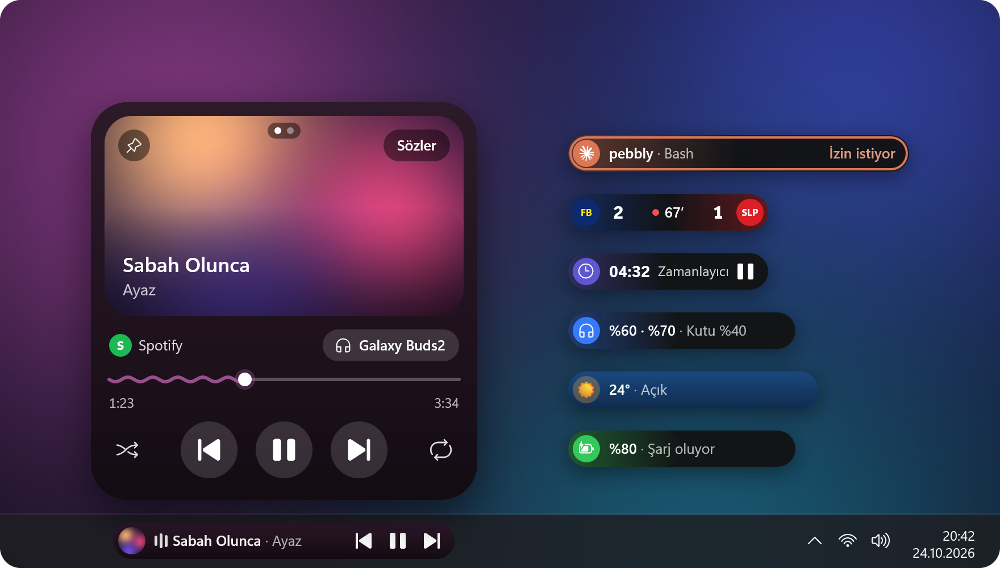
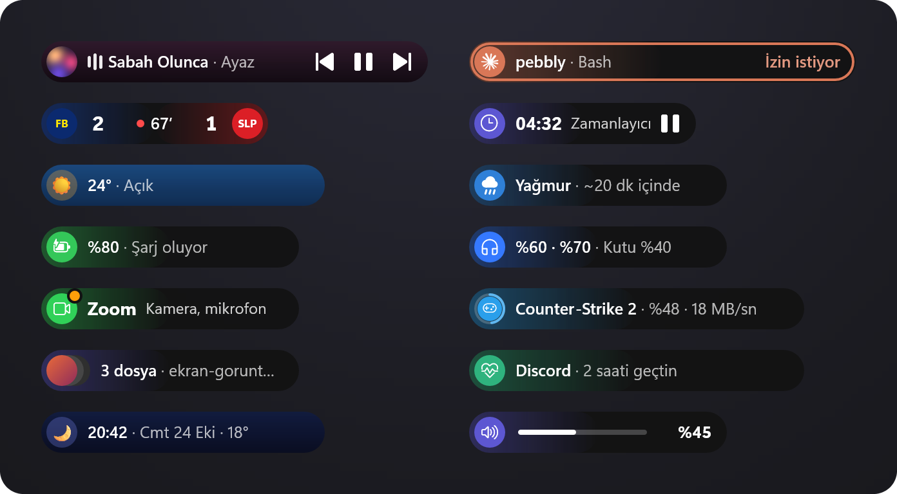
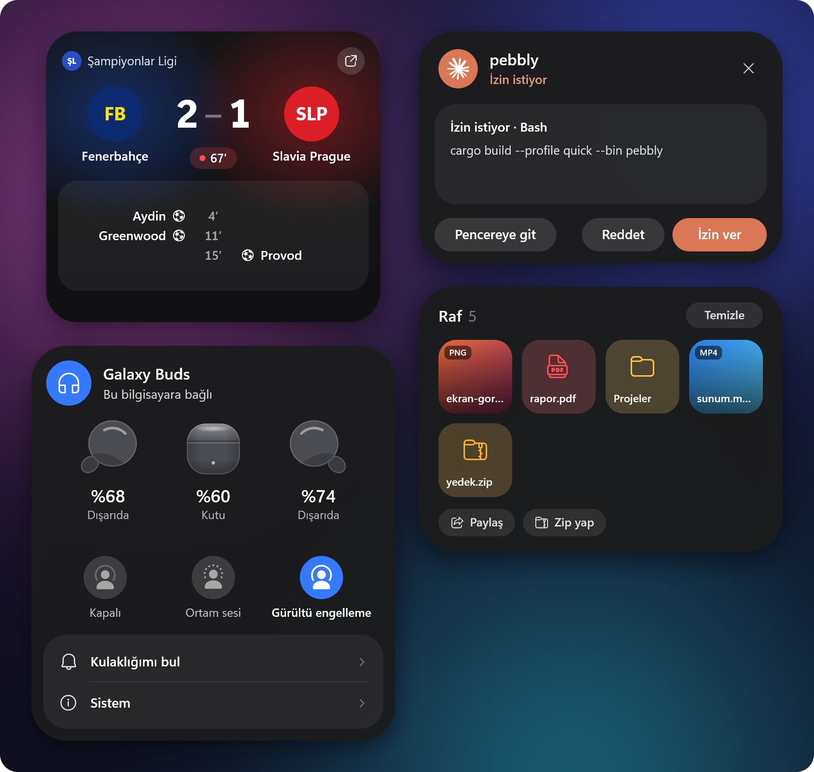
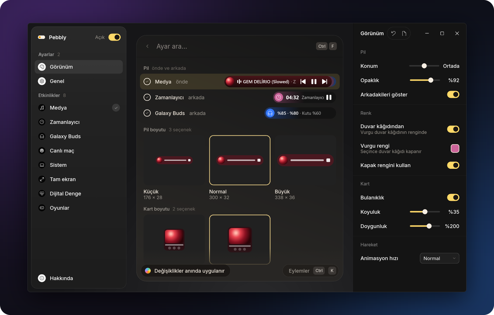
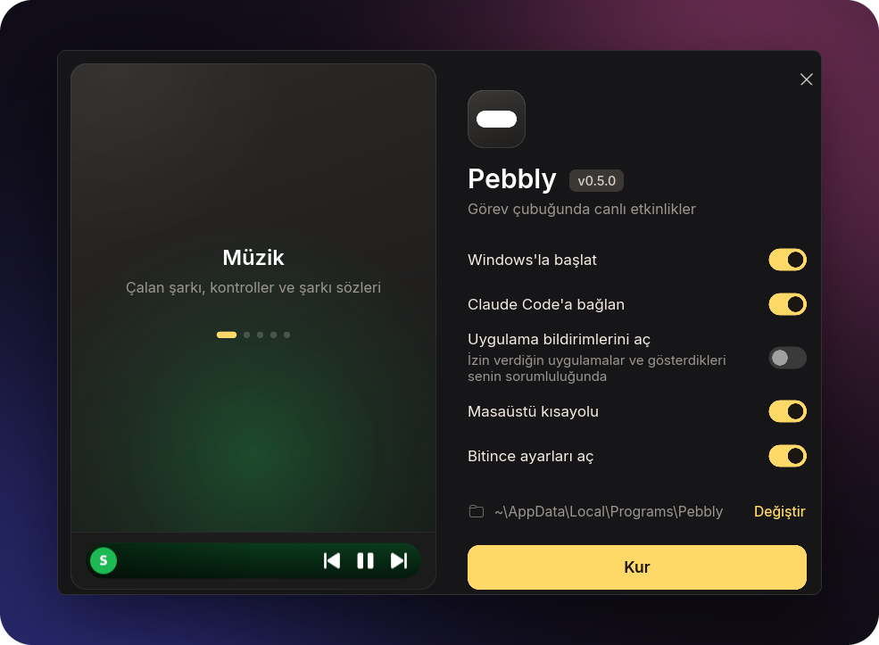

<div align="center">



# Now Bar

**Samsung One UI's Now Bar, in the Windows 11 and 10 taskbar.**

A small pill sits in the taskbar and shows what's going on right now: the song that's playing, a<br>
timer, a match's score, what Claude Code is doing. Click the pill and a card opens above it.

**[Download](https://github.com/nixesty/now-bar/releases/latest)** &nbsp;·&nbsp;
[What it shows](#what-it-shows) &nbsp;·&nbsp;
[Install](#install) &nbsp;·&nbsp;
[Building](#building)

[Türkçe](README.md) &nbsp;·&nbsp; **English**

</div>

<br>

The app speaks English and Turkish (Settings → General → Language; Windows' language by default).
The pictures on this page show it in Turkish.

## What it shows



- **Music:** any app that opens a media session in Windows (Spotify, YouTube Music, browsers).
  The pill takes the colour of the album cover; the card has the cover, a wavy progress bar,
  lyrics and a choice of audio output. When synced lyrics exist, the pill scrolls the current line
  instead of the song's title.
- **The week's music:** your most played songs and artists of the last seven days; opens from the
  Digital Wellbeing card or the tray menu.
- **Timer and stopwatch:** started from the picker (Win+Alt+N) or the tray menu; when time is up
  an alarm rings and the card opens.
- **Live match:** the score, minute and goals of the football and basketball teams you follow.
- **Weather:** the clock and the weather when nothing else is on; alerts for rain, snow, storms,
  strong wind, extreme heat, frost and poor air quality. Without a chosen city, the location comes
  from Windows.
- **Galaxy Buds:** the charge of both earbuds and the case, and noise control. With more than one
  pair of Buds paired, the settings pick which one is shown.
- **Claude Code:** what Claude is doing right now and its task list; when it asks for permission,
  the card shows **Allow / Deny** buttons ([below](#live-activities)).
- **Ask Claude:** Win+Alt+C or a Ctrl-click on the pill opens a text box in the card; the answer
  streams from Claude Code. Claude Code has to be installed and signed in on the PC (run `claude`
  once in a terminal, then `/login`).
- **Games:** Steam and Epic Games downloads, updates, pauses and play time.
- **Digital Wellbeing:** the day's screen time, each app's share and the limits you set.
- **Shelf:** files you drop on the pill wait there until you drag them where you want them; new
  screenshots join the shelf by themselves. The buttons under the card act on the files you
  selected (or on all of them with no selection): **Share** (Windows' share window; to your phone
  too if Quick Share is installed), **Copy text** (puts the text in a screenshot on the
  clipboard), **Shrink** (saves the picture as a JPEG next to the original, its long side 1920
  pixels at most) and **Zip**.
- **File copying:** while Explorer copies, moves or deletes, the pill shows the percentage and the
  time left, even with Explorer's window minimised.
- **While you were away:** if the PC was locked for at least a minute and something happened
  meanwhile, the pill shows "While you were away" when you unlock it; a click lists what happened:
  work Claude finished, goals, rain and weather alerts, finished downloads, timers, app
  notifications.
- **System:** volume, charging and the low battery warning, the app using the microphone or the
  camera, and the charge of Bluetooth headphones.
- With more than one activity at a time, thin strips show to the right of the one in front; turn
  the mouse wheel over the pill to switch between them. While a game, a video or a slideshow is
  full screen the pill hides; what can't wait (Claude asking permission, a weather alert) shows on
  a small island at the top of the screen.

## Cards


The card grows out of the pill and shrinks back when the mouse leaves. On the music card,
**Lyrics** in the cover's corner opens the lyrics; they come from `lrclib.net`, or when it doesn't
have them from NetEase Cloud Music or Kugou, and they flow with the song. When none of them has the
lyrics of a slowed or sped-up edit, the original's are stretched to its length.


When nothing else is on, a click on the clock opens the day's summary: the weather, matches, the
last song played and screen time.



## Settings



The settings window opens from **Settings…** in the tray menu; every change shows on the pill at
once. The search bar at the top finds settings; on the Live match page it searches for teams, on
the Full screen page it adds exceptions. Ctrl+F goes to the search, Ctrl+K to the actions menu.

## Install



Download `nowbar-setup.exe` from the [latest release](https://github.com/nixesty/now-bar/releases/latest)
and run it. It needs no admin rights and installs to `%LOCALAPPDATA%\Programs\NowBar` (**Change**
picks another folder). The options on the setup screen:

- **Start with Windows**
- **Connect to Claude Code** (shown when Claude Code is on the PC)
- **Turn on app notifications** (off by default): lets other apps show notifications on the pill
  ([below](#live-activities)). The apps you allow, and what they show, are your responsibility.
- **Desktop shortcut**
- **Open settings when done**

A Start menu shortcut is always added. Now Bar shows in Windows' "Settings → Apps" list and can be
uninstalled from there. Uninstalling also removes the shortcuts, the start with Windows entry and
the Claude Code hooks; deleting the settings is up to you.

<br clear="right">

Running the setup again while Now Bar is installed updates or repairs it: the running Now Bar is
closed, its files are replaced and it starts again.

For a silent install use `nowbar-setup.exe --quiet` (it leaves the app notifications setting as it
is); for a silent uninstall, `"%LOCALAPPDATA%\Programs\NowBar\nowbar-setup.exe" --uninstall --quiet`.

## Usage

| What | How |
|---|---|
| Open / close the card | Click the pill; the card closes by itself when the mouse leaves |
| Play / pause | Middle-click the pill |
| Switch between activities | Mouse wheel over the pill or the card |
| Timer picker | Win+Alt+N (can be changed in Settings → General) |
| Ask Claude | Win+Alt+C or Ctrl-click the pill (can be changed in Settings → General) |
| Select files on the shelf | Click a file on the card; click again to deselect it |
| Tray menu | Now Brief, Digital Wellbeing, The week's music, Ask Claude, Start a timer, Start the stopwatch, Start with Windows, Settings…, Quit; **Update: x.y.z** at the top when there's a new version, **Open the match page** and **Hide the match** during a match |

## Live activities

Another program or a script can show an activity on the pill. When Now Bar isn't running, the
command quits without doing anything (its exit code is always 0 and it prints nothing):

```
nowbar.exe push --id backup --title "Backup" --text "Documents" --progress 40
nowbar.exe push --id backup --title "Backup" --state done
```

`--state`: `run` (the default), `wait` (waiting for the user; comes to the front for a moment),
`done` (shows "Done" for 5 seconds), `clear` (removes it at once). An activity not updated for an
hour goes away by itself. Settings → System → Live activities turns this off.

**An API for apps:** other apps can show a notification or a live activity on the pill with a
single HTTP request, with their own icon, colour and up to two buttons. The API answers only on
this PC (`127.0.0.1:20034`) and stays off until you turn it on (**Turn on app notifications** in
the setup, or Settings → System → App notifications). The first time an app sends a request, the
pill asks whether it may ("Wants to show notifications"); your answer is remembered and can be
changed in the settings. The apps you allow, and what they show, are your responsibility; Now Bar
only shows it. For developers: [DOCS.md](DOCS.md).

```
curl -H "Content-Type: application/json" -d "{\"app\":\"Backup\",\"title\":\"Backup done\"}" http://127.0.0.1:20034/v1/notify
```

**Claude Code:** the setup's **Connect to Claude Code** option installs the hooks. To install or
remove them by hand, use the commands below. The command writes the exe's own path, keeps a backup
(`settings.json.before-nowbar` the first time, `settings.json.nowbar-last` on every later write)
and leaves other hooks alone:

```
nowbar.exe claude-hooks install
nowbar.exe claude-hooks remove
```

The pill shows what Claude is doing and for how long it has been working ("now-bar · Editing:
app.rs"); the card has the task list's progress, the last steps and, when the work is done, the
first line of the answer ("Done · 12 min · 9 files"). When Claude asks for permission the card
shows **Allow / Deny** buttons; this holds only for single-line commands, files, addresses and
searches the card shows in full. For a file, the card shows the file's full path while the change
itself stays in Claude's window; multi-line commands, questions and plan approval are answered
there as well. Claude's own window stays open at the same time; whichever answers first counts.
The card waits 60 seconds for an answer (Settings → System → Live activities). If Now Bar moves to
another folder, the hooks follow the new path the next time it starts. It works in the desktop
app's Code tab, the CLI and VS Code.

## Building

You need Rust (the MSVC toolchain) and, to embed the icon in the exes, the Windows SDK (`rc.exe`).
It builds without the SDK too, but then the exes keep Windows' default icon.

```
cargo b
```

`cargo b` is an alias defined in `.cargo\config.toml`: `cargo build --profile quick --bin nowbar
--bin nowbar-settings`. The exe runs as fast as a release build, but the program isn't optimised
as a whole (no LTO), so with a warm cache a build takes seconds. The settings window's interface
(`ui\`, Slint) is built without optimisation in this profile: a `.slint` change builds in 40
seconds instead of 4–5 minutes.

The output goes to `target\quick\`; clone the project to a short path (MSVC's path limit is 260
characters). The two exes (`nowbar.exe` and `nowbar-settings.exe`) must sit **in the same folder**:
Now Bar looks for the settings window next to itself. Copy both to `bin\` and run them from there.
With "Start with Windows" on, the startup entry follows the copy that ran last.

**Release:** `tools\make-setup.ps1` builds what a GitHub release carries into `dist\`:
`nowbar-setup.exe` (both exes inside), `nowbar.exe` and `nowbar-settings.exe` (what the updater
downloads) and `SHA256SUMS.txt`. The C runtime is linked statically, so the exes open on Windows
without the Visual C++ Redistributable. The release build (`target\dist\`, a few GB) is kept: the
first build takes 13–14 minutes, later ones build only what changed (about 5 minutes after a code
change). `-Clean` deletes that build at the end, `-Jobs` sets how many build jobs run at once.

```
powershell -ExecutionPolicy Bypass -File tools\make-setup.ps1 -Jobs 6
```

### Fonts

The pill and the card look in a `fonts\` folder next to the exe: One UI Sans if `OneUISans*.ttf`
is there (you can take it from your phone), otherwise `Inter*.ttf`, and without that Windows'
Segoe UI Variable. The settings window carries Inter inside it (`ui\fonts`, SIL Open Font
License).

## Files

- Settings: `%APPDATA%\NowBar\settings.json`
- Log: `%LOCALAPPDATA%\NowBar\log.txt`. When and why the pill hid goes here too
  (`pill: hidden (nothing active)`, `media: Brave left (paused 10 min)` and the like).
- Team crests: `%LOCALAPPDATA%\NowBar\crests\`
- The week's music: `%LOCALAPPDATA%\NowBar\music.json` (the last seven days only)
- Files the shelf makes (shrunk pictures, zips) are written next to their originals; when that
  folder can't be written to, into `%LOCALAPPDATA%\NowBar\Raf\`.

## Updates

A minute after it starts, and then once a day, Now Bar asks GitHub for the latest release
(`api.github.com`; nothing is sent but the request). When there's a newer one, **Update: x.y.z**
shows in the tray menu and a line in Settings → About. A click downloads the two exes, checks them
against `SHA256SUMS.txt`, puts them in place of the old ones and restarts Now Bar; the settings and
start with Windows stay as they are. If any step fails, the old exes stay. If Now Bar is installed
in a folder it can't write to (such as Program Files), the release page opens instead. Settings →
About → Check for updates turns the check off.

## Privacy and network

Where Now Bar connects (none of them needs an API key):

- **Lyrics:** the playing song's artist, title and length go to `lrclib.net`, and when it doesn't
  have the lyrics to NetEase Cloud Music (`music.163.com`) and Kugou (`lyrics.kugou.com`)
  (Settings → Media → Lyrics turns this off).
- **Weather:** the chosen city's coordinates go to Open-Meteo (`api.open-meteo.com`,
  `geocoding-api.open-meteo.com`). With **Use my location**, the location comes from Windows'
  location service (Windows asks first); to name the place, coordinates rounded to about 1 km go
  to OpenStreetMap (`nominatim.openstreetmap.org`).
- **Matches:** for the teams you follow, ESPN (`site.api.espn.com`) and EuroLeague/EuroCup
  (`feeds.incrowdsports.com`, `live.euroleague.net`); crests are downloaded from these sources'
  image addresses too.
- **Updates:** GitHub (`api.github.com`), as described above.
- **Ask Claude:** your question goes to Claude Code on the PC (`claude -p`, with no tools: it can't
  touch your files or the command line); Claude Code sends it to Anthropic with your own session.
  Now Bar itself connects nowhere.

What stays on this PC: the week's music is counted here; **Copy text** uses Windows' own text
recognition; **Share** only opens Windows' share window, and the files go where you choose there.

With **app notifications** on, Now Bar listens only on `127.0.0.1:20034` and `[::1]`, which only
this PC can reach (if the port is taken it uses another one Windows gives and writes it to
`%LOCALAPPDATA%\NowBar\api.json`). With them off, no port is opened. Requests from web pages, the
network and other Windows users on this PC are refused; the details are in [DOCS.md](DOCS.md).

Watched folders: ShareX's screenshot folder and Windows' `Pictures\Screenshots` folder (a new
screenshot shows on the pill for a moment and joins the shelf; Settings → System → Screenshots).
Claude Code's steps and permission requests show in the taskbar; keep that in mind while sharing
your screen.

## Known limits

- **Windows 11 or Windows 10 (1809 and later).** On Windows 10 the card's background isn't blurred
  (it uses a plain one) and the icons come from Segoe MDL2 Assets. Windows 10 support came in
  0.2.1; its placement in the taskbar has only been tried in a simulation so far.
- **Galaxy Buds:** tried with Buds2; Buds2 Pro, Buds FE, Buds Core, Buds3, Buds3 FE and Buds4 use
  the same protocol, and Buds Pro is recognised too. The first Galaxy Buds, Buds+ and Buds Live
  aren't supported. While GalaxyBudsClient or Samsung's Galaxy Buds app uses the connection, Now
  Bar can't read the earbuds.
- **Paused media leaves the pill after 10 minutes** (Settings → Media → Stay when paused). With no
  other activity, the pill hides then too; it comes back when the music plays again.
- The settings window doesn't show live data: instead of a match's live score, the Buds' current
  charge or a running timer, it shows a sample of that activity's pill.
- It works only in the main display's taskbar.
- Idle resource use (with media paused, measured 2026-10-21): 5–10 ms of CPU time every 10
  seconds, a 39–66 MB working set (25 MB private). The goal was 5 ms per 10 seconds and 50 MB.
- When Explorer restarts, the pill returns to the taskbar by itself; an open card closes.

## Development

```
cargo t
cargo lint
```

Tests and clippy (the aliases in `.cargo\config.toml`) run in the quick profile; a plain
`cargo test` builds a second full copy of the dependencies under `debug\` (tens of GB).

- What makes the build faster: Rust's own linker (`rust-lld`), no debug info in the dependencies,
  and the settings window's Slint interface in a crate of its own (`ui\`): the interface rebuilds
  only when a `.slint` file changes.
- `NOWBAR_SETTINGS_SHOTS=<folder> nowbar-settings.exe`: opens the settings window off-screen, takes
  a screenshot of every page with the real renderer and closes without saving the settings.
- `pillsheet`, `cardsheet`, `matchsheet`, `settingsheet`, `glyphsheet`: render sample pictures
  (PNG) without opening a window. `fxsheet` (the weather's effects), `glidesheet` (the pill making
  room for the taskbar's buttons) and `islandsheet` (the in-game island) photograph the moving
  ones frame by frame in a window off-screen. `readmesheet` with `tools\readme-images.py` redraws
  the pictures on this page (`assets\readme\`).
- `taskbarprobe`, `copyprobe`, `audioprobe`, `mediaprobe`, `footballprobe`: print the taskbar's
  elements, Explorer's copy windows, the audio outputs, the media sessions and the match data,
  read-only.
- **Translation:** the interface's text is written in Turkish in the code (`tr("…")`, in Slint
  `@tr("…")`); its English is in `i18n\en\LC_MESSAGES\nowbar-ui.po`. `python tools\i18n-extract.py`
  adds the missing strings to that file, empty; `cargo t` fails until each one has its English.
- `tools\*.ps1`: flicker, idle use, Explorer restarts and other measurements.
- `nowbar.exe --demo`: starts with a one-minute sample timer; `--match-replay <folder>` replays a
  match from recorded scoreboards.
- `assets\make_icon.py`: redraws the icon (the white pill in the tray).
- **Publishing a release:** raise `version` in `Cargo.toml`, run `tools\make-setup.ps1`, then
  publish what's in `dist\`:
  `gh release create vX.Y.Z dist\nowbar-setup.exe dist\nowbar.exe dist\nowbar-settings.exe dist\SHA256SUMS.txt`.
  `nowbar.exe --update-from <folder>` tries the update without GitHub, with the exes in a folder.

## License

Now Bar is licensed under the [GNU General Public License version 3](LICENSE) (GPL-3.0). You may
use, change and share the code; if you share a changed version, you have to publish its source
under the same license. Copyright © 2026 nixesty.

Not covered by this license:

- The Galaxy Buds noise control icons (`src/activities/buds.rs`, `NoiseControl::icon`) were drawn
  from Samsung's SystemUI and belong to Samsung; they also show in the README's pictures.
- Claude's mark (`src/render/pill.rs`, `CLAUDE_ICON`) belongs to Anthropic; it shows in the
  pictures too.
- The settings window's font, Inter, comes with its own license (SIL Open Font License,
  `ui\fonts\Inter-OFL.txt`).

---

<sub>Not affiliated with Samsung; an independent project inspired by One UI. The Galaxy Buds noise
control icons belong to Samsung.</sub>
