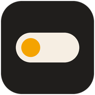
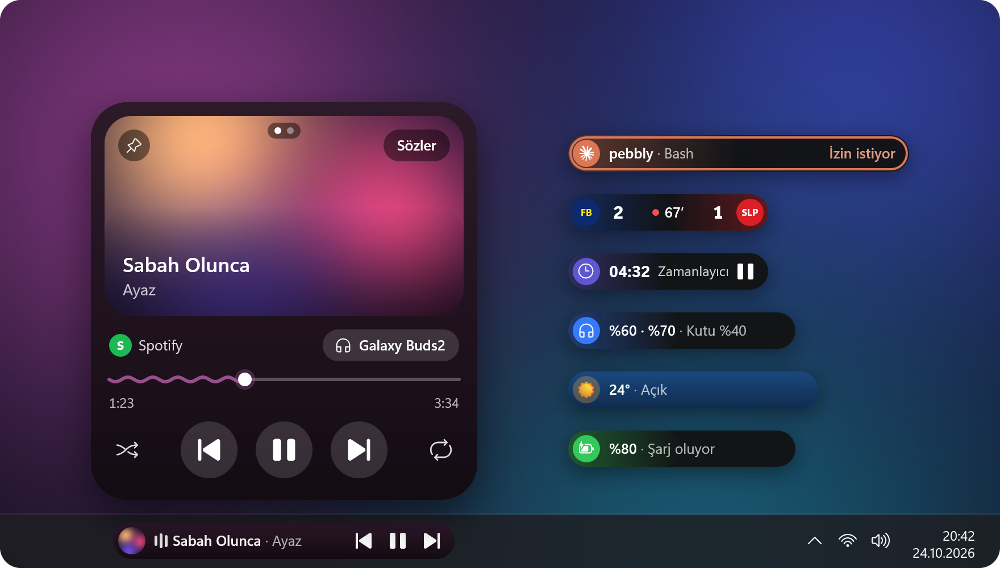
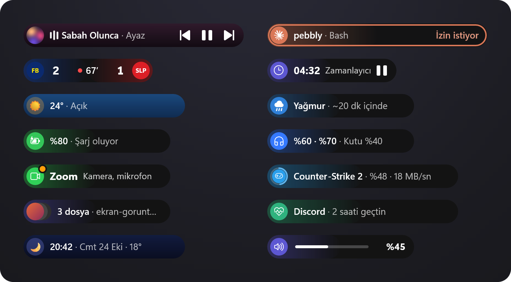
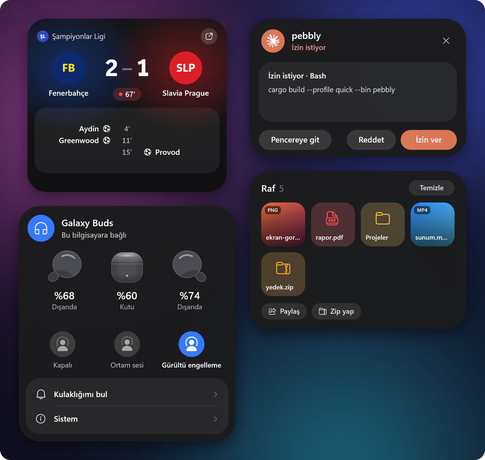
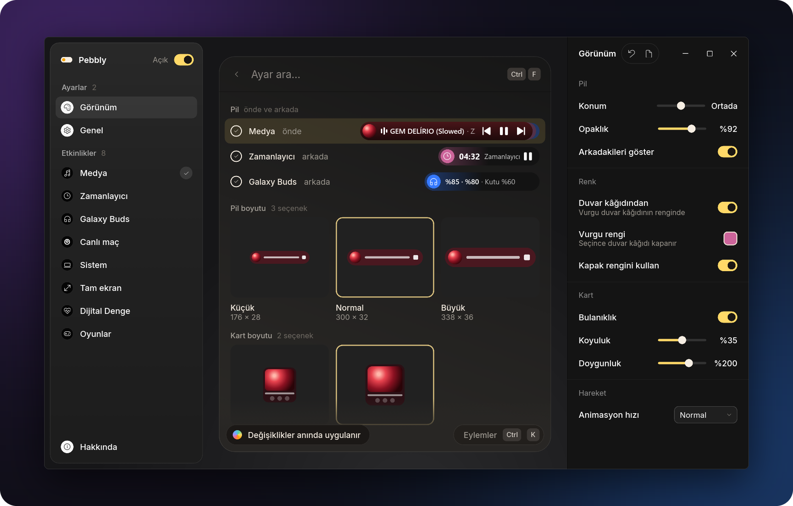
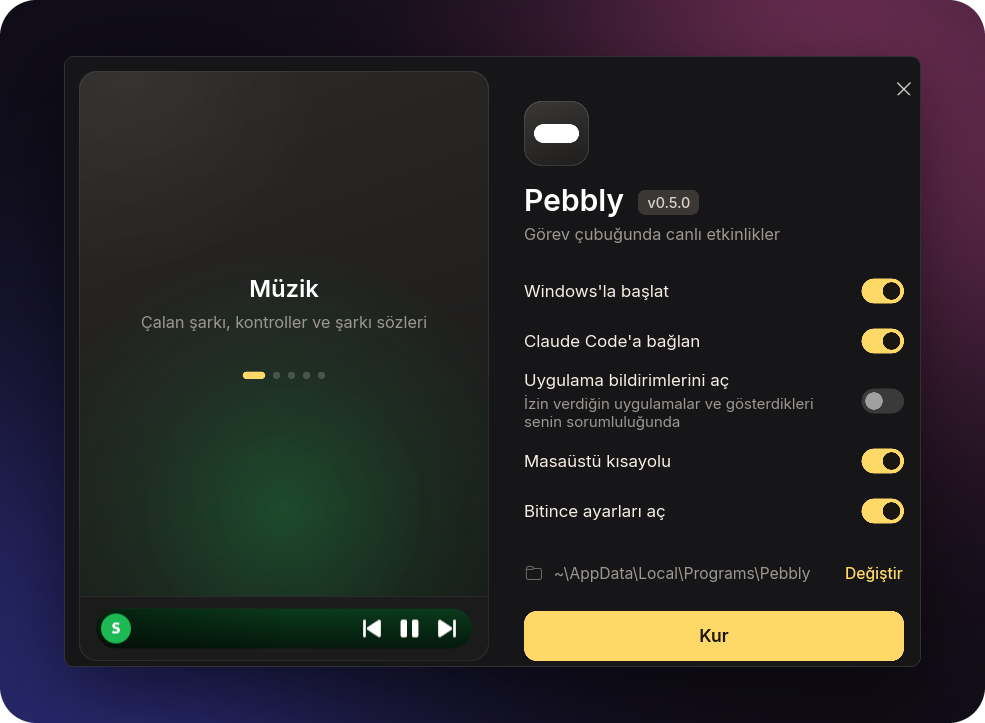

<div align="center">



# Pebbly

**Görev çubuğunda canlı etkinlikler.**<br>
Samsung One UI'daki Now Bar'dan esinlenen, Windows 11 ve 10 için küçük bir pil.

[](https://github.com/nixesty/pebbly/releases/latest)
[](#bilinen-sınırlar)
[](LICENSE)

**[İndir](https://github.com/nixesty/pebbly/releases/latest)** &nbsp;·&nbsp;
[pebbly.bar](https://pebbly.bar) &nbsp;·&nbsp;
[English](README.en.md)

<br>



</div>

<br>

Görev çubuğunda küçük bir pil durur ve o an olan biteni gösterir: çalan şarkı, zamanlayıcı, maçın
skoru, Claude Code'un ne yaptığı. Pile tıklayınca üstünde bir kart açılır; fare uzaklaşınca kart
pile geri döner. Arayüz Türkçe ve İngilizcedir.

## Neler gösterir



| Etkinlik | Ne gösterir |
|---|---|
| **Müzik** | Medya oturumu açan her uygulama (Spotify, YouTube Music, tarayıcılar). Pil kapağın rengini alır; eşzamanlı söz varsa şarkının adı yerine o anki satır kayar. |
| **Zamanlayıcı ve kronometre** | Seçiciden (Win+Alt+N) ya da tepsi menüsünden başlar; süre dolunca alarm çalar ve kart açılır. |
| **Canlı maç** | Takip ettiğin futbol ve basketbol takımlarının skoru, dakikası ve golleri. |
| **Hava durumu** | Boştayken saat ve hava; yağmur, kar, fırtına, kuvvetli rüzgâr, aşırı sıcak, don ve kötü hava kalitesinde uyarı. |
| **Galaxy Buds** | İki kulaklığın ve kutunun şarjı, gürültü kontrolü; kutuyu açınca bilgisayara bağlanmayı önerir. |
| **Claude Code** | Claude'un o an ne yaptığı, görev listesi ve izin istekleri; **Claude'a sor** ile kartta soru sorulur. |
| **Oyunlar** | Steam ve Epic Games indirmeleri, güncellemeleri, duraklatmaları ve oyun süresi. |
| **Dijital Denge** | Günün ekran süresi, uygulamaların payı, koyduğun sınırlar ve haftanın müziği. |
| **Raf** | Pile bıraktığın dosyalar ve yeni ekran görüntüleri; sonra istediğin yere sürüklersin. |
| **Dosya kopyalama** | Explorer kopyalarken, taşırken ya da silerken yüzde ve kalan süre. |
| **Sen yokken** | Bilgisayar kilitliyken olanlar: Claude'un bitirdiği işler, goller, uyarılar, biten indirmeler. |
| **Sistem** | Ses seviyesi, şarj ve düşük pil, mikrofonu ya da kamerayı kullanan uygulama, Bluetooth kulaklıklar. |

Aynı anda birden fazla etkinlik varsa öndekinin sağında ince şeritler görünür; pilin üzerinde fare
tekerleğini çevirerek aralarında geçilir. Oyun, video ya da sunum tam ekrandayken pil gizlenir;
bekleyemeyecek şeyler (Claude'un izin isteği, hava uyarısı) ekranın üstünde küçük bir adada belirir.

## Kartlar

### Müzik


Kartta kapak, dalgalı ilerleme çubuğu ve ses çıkışı seçimi bulunur. Kapağın köşesindeki **Sözler**
şarkı sözlerini açar: sözler `lrclib.net`'ten, orada yoksa NetEase Cloud Music'ten ya da Kugou'dan
gelir ve şarkıyla birlikte akar. Yavaşlatılmış (slowed) ya da hızlandırılmış bir sürümün sözleri
hiçbirinde yoksa orijinalinkiler onun uzunluğuna esnetilir.

### Gün


Boştayken saate tıklayınca günün özeti açılır: hava, maçlar, son çalan şarkı ve ekran süresi.
**Haftanın müziği** son yedi günde en çok dinlediğin şarkıları ve sanatçıları gösterir; Dijital
Denge kartından ya da tepsi menüsünden açılır.

### Canlı



- **Galaxy Buds** kartı Galaxy Wearable gibidir: kulaklıklar ve kutu, şarjları, nerede oldukları,
  sıcaklıkları, kalan dinleme süresi ve gürültü kontrolü. Buds2'de ekolayzer, ortam sesi, kulaklığımı
  bul, dokunmatik kontroller, dokunup tutma (istersen bilgisayarın mikrofonunu kapatır, şarkıyı
  geçer), kenara çift dokunma, görüşmede kendi sesini duyma, kesintisiz bağlantı ve uyum testi de
  vardır; bunlar kulaklıkta saklanır, telefonda da geçerlidir. Birden fazla Buds eşleştirilmişse
  hangisinin gösterileceği ayarlardan seçilir.
- **Claude Code** izin istediğinde kartta **İzin ver / Reddet** çıkar
  ([aşağıda](#uygulamalar-ve-betikler)).
- **Raf**'ın düğmeleri seçtiğin dosyalara (seçim yoksa hepsine) uygulanır: **Paylaş** (Windows'un
  paylaşım penceresi; Quick Share kuruluysa telefona da), **Metni kopyala** (ekran görüntüsündeki
  yazıyı panoya alır), **Küçült** (JPEG, uzun kenarı en fazla 1920 piksel, aslının yanına) ve
  **Zip yap**.

## Ayarlar



Ayarlar penceresi tepsi menüsündeki **Ayarlar…** ile açılır; her değişiklik pile anında yansır.
Üstteki arama ayarları bulur; Canlı maç sayfasında takım arar, Tam ekran sayfasında istisna ekler.
Ctrl+F aramaya, Ctrl+K eylemler menüsüne götürür. Dil Genel → Dil'den seçilir (varsayılan olarak
Windows'un dili).

## Kurulum



1. [Son sürümden](https://github.com/nixesty/pebbly/releases/latest) `pebbly-setup.exe`'yi indir.
2. Çalıştır. Yönetici izni istemez; `%LOCALAPPDATA%\Programs\Pebbly` klasörüne kurulur
   (**Değiştir** ile başka bir klasör seçilir).
3. Seçenekler: **Windows'la başlat**, **Claude Code'a bağlan** (Claude Code varsa görünür),
   **Uygulama bildirimlerini aç** (varsayılan olarak kapalı), **Masaüstü kısayolu**, **Bitince
   ayarları aç**.

Başlat menüsüne her zaman bir kısayol eklenir. Kurulumu yeniden çalıştırmak Pebbly'yi günceller ya
da onarır. Pebbly, Windows'un Ayarlar → Uygulamalar listesinden kaldırılır; kısayollar, Windows'la
başlatma ve Claude Code hook'ları da gider, ayarları silmek isteğe bağlıdır.

<br clear="right">

Sessiz kurulum: `pebbly-setup.exe --quiet` (uygulama bildirimleri ayarına dokunmaz). Sessiz
kaldırma: `"%LOCALAPPDATA%\Programs\Pebbly\pebbly-setup.exe" --uninstall --quiet`.

> [!NOTE]
> **Now Bar'dan geliyorsan:** Pebbly'nin eski adı Now Bar'dı. Now Bar 0.5.0 ya da daha eskisi,
> Hakkında'daki **Güncelle** satırıyla da `pebbly-setup.exe` ile de Pebbly'ye taşınır. Ayarlar,
> günlük ve önbellekler (`%APPDATA%\NowBar` ve `%LOCALAPPDATA%\NowBar` klasörleri `Pebbly` olur),
> Windows'la başlatma, Claude Code bağlantısı ve kısayollar olduğu gibi kalır;
> `%LOCALAPPDATA%\Programs\NowBar` yanındaki `Pebbly` klasörüne taşınır. Kendi betiklerinde
> `nowbar.exe push` varsa `pebbly.exe push` yap.

## Kullanım

| Ne | Nasıl |
|---|---|
| Kartı aç / kapat | Pile tıkla; fare uzaklaşınca kart kendiliğinden kapanır |
| Oynat / duraklat | Pile farenin orta tuşuyla tıkla |
| Etkinlikler arasında geç | Pilin ya da kartın üzerinde fare tekerleği |
| Zamanlayıcı seçicisi | Win+Alt+N (Ayarlar → Genel'den değişir) |
| Claude'a sor | Win+Alt+C ya da pile Ctrl ile tıkla (Ayarlar → Genel'den değişir) |
| Raftaki dosyaları seç | Kartta dosyaya tıkla; yeniden tıklayınca seçim kalkar |
| Tepsi menüsü | Now Brief, Dijital Denge, Haftanın müziği, Claude'a sor, Zamanlayıcı ve Kronometre başlat, Windows ile başlat, Ayarlar…, Çıkış; yeni sürüm varsa en üstte **Güncelle: x.y.z**, maç sürerken **Maç sayfasını aç** ve **Maçı gizle** |

**Claude'a sor** için bilgisayarda Claude Code kurulu ve oturumu açık olmalıdır (bir kez terminalde
`claude`, sonra `/login`).

## Uygulamalar ve betikler

**Betikten:** başka bir program ya da betik pilde bir etkinlik gösterebilir. Pebbly çalışmıyorsa
komut hiçbir şey yapmadan çıkar (çıkış kodu her zaman 0, çıktı yok):

```
pebbly.exe push --id yedek --title "Yedekleme" --text "Belgeler" --progress 40
pebbly.exe push --id yedek --title "Yedekleme" --state done
```

`--state`: `run` (varsayılan), `wait` (kullanıcıyı bekliyor; bir an öne gelir), `done` (5 saniye
"Bitti" gösterir), `clear` (hemen kaldırır). Bir saat güncellenmeyen etkinlik kendiliğinden kalkar.
Ayarlar → Sistem → Canlı etkinlikler bunu kapatır.

**Uygulamalar için API:** başka uygulamalar tek bir HTTP isteğiyle pilde bildirim ya da canlı
etkinlik gösterebilir; kendi ikonları, renkleri ve en fazla iki düğmeyle. API'ye yalnızca bu
bilgisayardan (`127.0.0.1:20034`) erişilir ve sen açana kadar kapalıdır (kurulumda **Uygulama
bildirimlerini aç** ya da Ayarlar → Sistem → Uygulama bildirimleri). Bir uygulama ilk kez istek
gönderince pil "Bildirim göstermek istiyor" diye sorar; cevabın hatırlanır. İzin verdiğin
uygulamalar ve gösterdikleri senin sorumluluğundadır; Pebbly yalnızca gösterir. Geliştiriciler
için: [DOCS.md](DOCS.md).

```
curl -H "Content-Type: application/json" -d "{\"app\":\"Yedekleyici\",\"title\":\"Yedek bitti\"}" http://127.0.0.1:20034/v1/notify
```

**Claude Code:** kurulumdaki **Claude Code'a bağlan** hook'ları kurar; elle kurmak ya da kaldırmak
için aşağıdakiler kullanılır. Komut exe'nin kendi yolunu yazar, ilk seferde
`settings.json.before-pebbly`, sonraki her yazışta `settings.json.pebbly-last` adıyla yedek alır
ve başka hook'lara dokunmaz:

```
pebbly.exe claude-hooks install
pebbly.exe claude-hooks remove
```

Pil, Claude'un ne yaptığını ve ne kadar süredir çalıştığını gösterir ("pebbly · Düzenliyor:
app.rs"); kartta görev listesinin ilerlemesi, son adımlar ve iş bitince cevabın ilk satırı
("Bitti · 12 dk · 9 dosya") bulunur. Kartın **İzin ver / Reddet** düğmeleri yalnızca kartta tamamı
görünen tek satırlık komutlar, dosyalar, adresler ve aramalar içindir; dosya izinlerinde kartta
dosyanın tam yolu görünür, değişikliğin kendisi Claude'un penceresinde kalır. Çok satırlı komutlar,
sorular ve plan onayı Claude'un penceresinde cevaplanır. İki taraf da açıktır; hangisi önce cevap
verirse o geçerlidir. Kart 60 saniye bekler (Ayarlar → Sistem → Canlı etkinlikler). Masaüstü
uygulamasının Code sekmesinde, CLI'da ve VS Code'da çalışır; Pebbly başka bir klasöre taşınırsa
hook'lar bir sonraki açılışta yeni yolu izler.

## Güncelleme

Pebbly açıldıktan bir dakika sonra ve ardından günde bir kez GitHub'a son sürümü sorar
(`api.github.com`; sorgu dışında hiçbir şey gönderilmez). Ayarlar → Hakkında'daki **Denetle**
beklemeden sorar. Yeni sürüm varsa tepsi menüsünde **Güncelle: x.y.z** belirir, Hakkında'daki satır
da **Güncelle** olur. Tıklayınca iki exe indirilir, `SHA256SUMS.txt` ile doğrulanır, eskilerinin
yerine konur ve Pebbly yeniden başlar; açık ayarlar penceresi de yeni sürümüyle yerinde açılır.
Hakkında satırı o sırada ne olduğunu, olmazsa nedenini yazar; bir adım başarısız olursa eski exe'ler
yerinde kalır. Pebbly'nin yazamadığı bir klasöre (Program Files gibi) kurulduysa sürüm sayfası
açılır. Günlük denetim Ayarlar → Hakkında → Güncellemeleri denetle ile kapanır.

## Dosyalar

| Ne | Nerede |
|---|---|
| Ayarlar | `%APPDATA%\Pebbly\settings.json` |
| Günlük | `%LOCALAPPDATA%\Pebbly\log.txt`: pilin ne zaman ve neden gizlendiği de buradadır (`pill: hidden (nothing active)` gibi) |
| Takım armaları | `%LOCALAPPDATA%\Pebbly\crests\` |
| Haftanın müziği | `%LOCALAPPDATA%\Pebbly\music.json` (yalnızca son yedi gün) |
| Raftan çıkanlar | Küçültülmüş resimler ve zip'ler asıllarının yanına; oraya yazılamazsa `%LOCALAPPDATA%\Pebbly\Raf\` |

## Gizlilik ve ağ

Pebbly'nin bağlandığı yerler; hiçbiri API anahtarı istemez:

| Ne | Nereye | Ne gider |
|---|---|---|
| Şarkı sözleri | `lrclib.net`, sonra NetEase Cloud Music (`music.163.com`) ve Kugou (`lyrics.kugou.com`) | Çalan şarkının sanatçısı, adı ve süresi (Ayarlar → Medya → Şarkı sözleri ile kapanır) |
| Hava durumu | Open-Meteo (`api.open-meteo.com`, `geocoding-api.open-meteo.com`) | Seçilen şehrin koordinatları |
| Yerin adı | OpenStreetMap (`nominatim.openstreetmap.org`) | **Konumumu kullan** seçiliyse yaklaşık 1 km'ye yuvarlanmış koordinatlar (konum Windows'tan, Windows izin ister) |
| Maçlar | ESPN (`site.api.espn.com`), EuroLeague/EuroCup (`feeds.incrowdsports.com`, `live.euroleague.net`) | Takip edilen takımlar için skor istekleri; armalar da bu kaynaklardan |
| Güncelleme | GitHub (`api.github.com`) | Yalnızca son sürüm sorgusu |
| Claude'a sor | Bilgisayardaki Claude Code (`claude -p`, araçsız) | Yazdığın soru; Claude Code onu kendi oturumunla Anthropic'e gönderir |

Bu bilgisayarda kalanlar: haftanın müziği burada sayılır; **Metni kopyala** Windows'un kendi metin
tanımasını kullanır; **Paylaş** yalnızca Windows'un paylaşım penceresini açar. Eşleştirilmiş Buds
bu bilgisayara bağlı değilken Pebbly, kutunun açıldığını görmek için yakındaki Bluetooth LE
yayınlarını dinler (yalnızca dinler, hiçbir şey göndermez); Ayarlar → Galaxy Buds → **Kutu açılınca
bağlanmayı öner** bunu kapatır.

**Uygulama bildirimleri** açıksa Pebbly yalnızca bu bilgisayardan erişilen `127.0.0.1:20034` ve
`[::1]` adreslerini dinler (port doluysa Windows'un verdiği başka bir portu `%LOCALAPPDATA%\Pebbly\api.json`
dosyasına yazar); kapalıyken hiçbir port açılmaz. Web sayfalarından, ağdan ve bu bilgisayardaki
diğer Windows kullanıcılarından gelen istekler reddedilir. ShareX'in ekran görüntüsü klasörü ve
Windows'un `Resimler\Screenshots` klasörü izlenir (Ayarlar → Sistem → Ekran görüntüleri). Claude
Code'un adımları ve izin istekleri görev çubuğunda görünür; ekran paylaşırken bunu unutma.

## Bilinen sınırlar

- **Windows 11 ya da Windows 10 (1809 ve sonrası).** Windows 10'da kartın arkası bulanıklaşmaz ve
  simgeler Segoe MDL2 Assets'ten gelir; Windows 10'un görev çubuğundaki yerleşim henüz yalnızca
  simülasyonla denendi.
- **Galaxy Buds:** Buds2'de denendi; Buds2 Pro, Buds FE, Buds Core, Buds3, Buds3 FE ve Buds4 aynı
  protokolü kullanır, Buds Pro da tanınır. İlk Galaxy Buds, Buds+ ve Buds Live desteklenmez.
  GalaxyBudsClient ya da Samsung'un Galaxy Buds uygulaması bağlantıyı kullanırken Pebbly kulaklığı
  okuyamaz.
- Duraklatılan medya 10 dakika sonra pilden kalkar (Ayarlar → Medya → Duraklayınca kal).
- Ayarlar penceresi canlı verileri değil, her etkinliğin pilinden örnek bir görünüm gösterir.
- Yalnızca ana ekranın görev çubuğunda çalışır. Explorer yeniden başlarsa pil kendiliğinden geri
  döner; açık bir kart kapanır.
- Boştaki kullanım (medya duraklatılmışken, 2026-10-21): 10 saniyede 5–10 ms işlemci süresi,
  39–66 MB çalışma kümesi (25 MB özel bellek).

## Geliştirme

<details>
<summary><b>Derleme, test, araçlar ve sürüm</b></summary>

<br>

Gerekenler: Rust (MSVC araç zinciri) ve simgenin exe'lere gömülmesi için Windows SDK (`rc.exe`);
SDK olmadan da derlenir, ama exe'ler Windows'un varsayılan simgesiyle kalır.

```
cargo b
cargo t
cargo lint
```

Bunlar `.cargo\config.toml`'daki kısaltmalardır ve hepsi quick profilinde çalışır: sürüm derlemesi
kadar hızlı bir exe, ama programın tamamı birlikte optimize edilmez (LTO yok), bu yüzden önbellek
doluyken derleme saniyeler sürer. `cargo lint` clippy'yi derlemenin içinde çalıştırır. Düz
`cargo build` ya da `cargo test` bağımlılıkların ikinci bir tam kopyasını derler (onlarca GB).

Çıktılar `target\quick\` klasörüne yazılır; projeyi kısa bir yola klonla (MSVC'nin yol sınırı 260
karakter). `pebbly.exe` ve `pebbly-settings.exe` **aynı klasörde** olmalıdır: Pebbly ayarlar
penceresini kendi yanında arar. İkisini `bin\` klasörüne kopyalayıp oradan çalıştır; Windows'la
başlatma açıksa başlangıç kaydı en son çalışan kopyayı izler.

**Yazı tipleri:** pil ve kart, exe'nin yanındaki `fonts\` klasörüne bakar: `OneUISans*.ttf` varsa
One UI Sans'ı (telefonundan alabilirsin), yoksa `Inter*.ttf`'yi, o da yoksa Windows'un Segoe UI
Variable'ını kullanır. Ayarlar penceresi Inter'i kendi içinde taşır (`ui\fonts`).

**Çeviri:** arayüz metinleri kodda Türkçe yazılır (`tr("…")`, Slint'te `@tr("…")`); İngilizceleri
`i18n\en\LC_MESSAGES\pebbly-ui.po` dosyasındadır. `python tools\i18n-extract.py` eksik metinleri
bu dosyaya boş olarak ekler; her birinin İngilizcesi yazılana kadar `cargo t` başarısız olur.

**Araçlar:**

- `cargo sheet <ad> -- <argümanlar>`: pencere açmadan örnek görüntüler (PNG) üretir: `pillsheet`,
  `cardsheet`, `matchsheet`, `settingsheet`, `glyphsheet` (`--en` ile İngilizce). `fxsheet` (havanın
  efektleri), `glidesheet` (pilin görev çubuğu düğmelerine yer açması) ve `islandsheet` (oyun içi
  ada) hareketli olanları ekran dışındaki bir pencerede kare kare çeker.
- `readmesheet` ve `tools\readme-images.py` bu sayfanın görsellerini yeniden çizer
  (`assets\readme\`, İngilizceleri `assets\readme\en\`).
- `PEBBLY_SETTINGS_SHOTS=<klasör> pebbly-settings.exe`: ayarlar penceresinin her sayfasını ekran
  dışında, gerçek çiziciyle çeker ve kaydetmeden kapanır.
- `taskbarprobe`, `copyprobe`, `audioprobe`, `mediaprobe`, `footballprobe`: görev çubuğunu,
  Explorer'ın kopyalama pencerelerini, ses çıkışlarını, medya oturumlarını ve maç verisini yalnızca
  okuyarak yazdırır.
- `pebbly.exe --demo` bir dakikalık örnek zamanlayıcıyla başlar; `--match-replay <klasör>`
  kaydedilmiş skor tablolarıyla bir maçı yeniden oynatır; `--update-from <klasör>` güncellemeyi
  GitHub olmadan dener.
- `tools\*.ps1`: titreme, boştaki kullanım, Explorer'ın yeniden başlaması ve diğer ölçümler.
  `assets\make_icon.py` simgeyi yeniden çizer.

**Sürüm yayınlamak:** `Cargo.toml`'daki `version`'ı artır ve `tools\make-setup.ps1`'i çalıştır.
Sürümün dosyalarını sıfırdan, statik C çalışma zamanıyla (Visual C++ Redistributable gerekmez)
`dist\` klasörüne derler ve sonunda derleme klasörünü siler (`-Keep` saklar, `-Jobs` aynı anda
kaç iş çalışacağını belirler; varsayılan 2 ile yarım saat kadar sürer). Sonra:

```
gh release create vX.Y.Z dist\pebbly-setup.exe dist\pebbly.exe dist\pebbly-settings.exe dist\nowbar.exe dist\nowbar-settings.exe dist\SHA256SUMS.txt
```

`nowbar.exe` (kurulumun kendisi) ve `nowbar-settings.exe`, Now Bar 0.2–0.5'in güncelleyicisi
içindir: o yalnızca bu adları indirir ve `nowbar.exe`'yi başlatır; kurulum da o kopyayı Pebbly'ye
taşır. Her sürümde bulunmaları gerekir.

</details>

## Lisans

Pebbly, [GNU Genel Kamu Lisansı sürüm 3](LICENSE) (GPL-3.0) ile lisanslıdır: kodu kullanabilir,
değiştirebilir ve dağıtabilirsin; değiştirip dağıttığın sürümün kaynak kodunu da aynı lisansla
açman gerekir. Telif hakkı © 2026 nixesty.

Bu lisansın dışında kalanlar:

- Galaxy Buds'ın gürültü kontrolü simgeleri (`src/activities/buds.rs`, `NoiseControl::icon`)
  Samsung'un SystemUI'ından çizildi ve Samsung'a aittir; README görsellerinde de görünürler.
- Galaxy Buds görselleri (`assets/buds/`; Buds Pro, Buds2, Buds2 Pro, FE, Core, Buds3 ve Buds4
  aileleri) [GalaxyBudsClient](https://github.com/timschneeb/GalaxyBudsClient)'tan alındı;
  Samsung'un ürün görselleridir ve Samsung'a aittir.
- Claude'un işareti (`src/render/pill.rs`, `CLAUDE_ICON`) Anthropic'e aittir; o da görsellerde
  görünür.
- Ayarlar penceresinin yazı tipi Inter, kendi lisansıyla gelir (SIL Open Font License,
  `ui\fonts\Inter-OFL.txt`).

---

<sub>Samsung ile bir ilgisi yoktur; One UI'daki Now Bar'dan esinlenmiş bağımsız bir projedir.
Galaxy Buds'ın gürültü kontrolü simgeleri ve kulaklık görselleri Samsung'a aittir.</sub>
